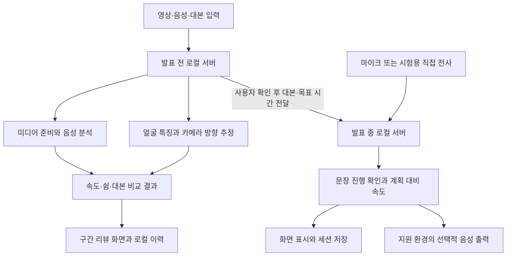

# 발표 도우미 곁 아키텍처 설계서

2026-10-12 추가: 발표 중 서버에 `/after` 화면을 연결했다. `src/presentation_after.py`가 저장된 발표 JSON을 읽어 리뷰를 계산하고 `qa/`에 질문·보충 자료를 별도로 저장한다. `src/question_audio.py`는 기존 음성 인식기를 재사용하며 최대 60초 녹음을 임시 처리한다. `src/maum_contract.py`는 제안 함수 토큰과 인자의 해석·근거 검사를 담당한다. 마음AI SDK 호출 구현은 포함되지 않는다. [현재 전체 현황](../completion_2026-10-12.md).

작성일: 2026-10-12. 버전: 0.1. 현재 PC 구조와 보드 적용 경계를 기록한다.

## 현재 시스템 구성

## 모듈과 책임

| 계층 | 실제 파일 | 책임 |
| --- | --- | --- |
| 실행 | `scripts/run_by_your_side.py`, `src/app_suite.py` | 두 서버 생성·종료, 화면 주소와 자료 전달 연결 |
| 발표 전 UI·서버 | `web/`, `src/review_server.py` | 입력·분석 요청·기록 관리·부분 재생 |
| 발표 전 분석 | `review_media.py`, `review_worker.py`, `review_audio.py`, `review_gaze.py`, `review_analysis.py` | 미디어 준비, 발화 분석, 카메라 방향 추정, 측정값 구성 |
| 발표 전 저장 | `src/review_db.py` | SQLite 이력 목록과 기록 관리 |
| 발표 중 UI·서버 | `web/presentation/`, `src/presentation_server.py` | 세션 명령, 상태 조회, 마이크 관리 |
| 발표 중 처리 | `pipeline.py`, `stt.py`, `vad.py`, `presentation.py`, `script_coaching.py` | 음성 구간화·인식, 대본 진행·시간 상태 관리 |
| 선택적 의미·음성 처리 | `ollama_coach.py`, `voice_feedback.py` | 로컬 의미 모델 연결과 음성 안내 정책 |
| 마음AI 연결 경계 | `src/review_handoff.py` | 허용된 측정 근거와 프롬프트 구성. 실제 SDK 호출은 미구현 |

## 저장과 인터페이스 경계

발표 전 자료는 `recordings/reviews/`에 미디어·분석 JSON으로 보관하고 SQLite로 목록을 관리한다. 발표 중은 `logs/presentation_sessions/`에 세션 JSON을 저장한다. 두 저장 형식은 현재 독립적이다. 두 화면은 기본 8765·8766 포트의 별도 루프백 서버이며, 통합 실행이 객체 호출로 대본 준비 명령을 연결한다.

영상의 시간은 미디어 시작 기준, 발표 중 시간은 세션 기준이다. 서버의 상태 조회 시각을 발화 시각으로 대신하지 않는다. 사용자 대본과 전사는 데이터로 취급하며 모델 출력은 상태와 근거를 검증한 뒤 사용한다.

## 클라우드와 보드 역할

클라우드 GPU는 학습·평가 실험에 사용하고, 최종 실행 모델과 전후처리 규격을 버전별로 보관하는 개발 환경으로 계획한다. 실제 클라우드 연결·업로드는 수행하지 않았다.

QCS6490에서는 입력 → 추론 → 측정·정책 → 표시의 모듈 계약을 재사용한다. OS와 SDK에 맞춰 실행 계층을 구현하고, 원본 모델과 같은 입력의 기준 출력을 비교한다. 현재 Python 패키지가 그대로 설치되거나 NPU에서 실행된다고 가정하지 않는다. 구체적인 런타임·백엔드·변환 형식은 공급 자료 확인 후 확정한다.
